# TinyDB architecture

TinyDB is a small document database written in pure Python. A database is one
dictionary (`{table_name: {doc_id: document}}`) that is read from and written to
a pluggable storage as a whole. This file describes the components in
`tinydb/`, three design decisions, and the rules to keep when changing the code.

## 1. Components

| Component | File | Job |
|---|---|---|
| `TinyDB` | `database.py` | Entry point. Creates the storage instance, hands out `Table` objects by name, forwards unknown attributes to the default table. |
| `Table` | `table.py` | All document operations (insert, search, update, remove, ...) on one named table. Owns the per-table query cache. |
| `Query` / `QueryInstance` | `queries.py` | The query language. Builds callables that test one document and carry a hash value that identifies the query. |
| `Storage`, `JSONStorage`, `MemoryStorage` | `storages.py` | Persistence. A storage reads and writes the complete database dictionary. |
| `Middleware`, `CachingMiddleware` | `middlewares.py` | Wrappers that sit between `TinyDB` and a storage class to add behaviour such as caching. |
| `LRUCache`, `FrozenDict`, `freeze` | `utils.py` | Helpers: the cache class used for query results, and making values hashable so they can be part of a query hash. |
| `operations` | `operations.py` | Ready-made update functions (`delete`, `add`, `set`, `increment`, ...) that are passed to `Table.update`. |

Who uses whom:

```mermaid
flowchart TD
    DB[TinyDB<br/>database.py] -->|creates and holds| ST[Storage<br/>storages.py]
    DB -->|table name| TB[Table<br/>table.py]
    TB -->|read / write whole dict| ST
    TB -->|calls cond doc, uses hash| Q[Query<br/>queries.py]
    TB -->|query result cache| U[utils.py<br/>LRUCache]
    Q -->|freeze for hashing| U
    MW[Middleware<br/>middlewares.py] -->|wraps the storage class| ST
    DB -.->|storage=Middleware&#40;StorageClass&#41;| MW
    OP[operations.py] -.->|functions passed to update| TB
```

Typical flow of `db.search(where('a') == 1)`: `TinyDB.__getattr__` forwards the
call to the default `Table`. `Table.search` looks the query up in its cache,
otherwise reads the table from the storage, keeps documents for which the
query callable returns true, stores the result in the cache and returns it.
Every write goes through `Table._update_table`, which reads the whole database
from the storage, changes one table, writes everything back and clears the
query cache.

## 2. Architecture decisions

### ADR-1: The storage interface moves the whole database
- **Status:** Verified (code comment, `table.py:808-810`).
- **Context:** TinyDB must work with very different backends (a file, memory,
  user supplied ones) and stay tiny.
- **Decision:** A `Storage` has only `read()` returning the complete database
  dictionary (or `None` when empty) and `write(data)` taking the complete
  dictionary. `Table._update_table` does read, modify, write.
- **Alternatives considered:** a storage API with per-document or per-table
  operations; letting tables talk to the file directly.
- **Consequences:** New storages are very easy to write (two methods). Every
  write rewrites all data, which is slow for large databases, and that is the
  reason a caching wrapper exists.

### ADR-2: Query results are cached by query hash and cleared on every write
- **Status:** Verified (docstring `table.py:48-50`, code `table.py:853-854`).
- **Context:** Repeated identical searches should not scan all documents.
- **Decision:** Each `Table` keeps an `LRUCache` mapping a query to its result
  list. A query is looked up by its hash, so every `Query` carries a hash value
  built from the operator name, the path and the arguments. Queries that cannot
  be hashed, or that contain callables (`Query.map`), are not cacheable. Any
  write clears the table's cache completely.
- **Alternatives considered:** no cache; invalidating only the affected
  entries (these are my inference, the code does not discuss them).
- **Consequences:** Reads are fast and invalidation is trivial. Two different
  queries that produce the same hash would wrongly share results, so the hash
  must identify a query completely.

### ADR-3: Middlewares wrap a storage class, not an instance
- **Status:** Verified (docstring `middlewares.py:26-58`).
- **Context:** Behaviour such as caching or logging should be addable to any
  storage without changing it.
- **Decision:** A middleware is created from a storage class and is itself
  callable: `TinyDB(storage=Middleware(StorageClass))`. When `TinyDB` calls it
  like a class, `__call__` builds the real storage with the received arguments
  and returns the middleware instance. Unknown attributes are forwarded to the
  wrapped storage, so a middleware looks like a storage and can be nested.
- **Alternatives considered:** subclassing every storage; wrapping an already
  built storage instance (these are my inference).
- **Consequences:** Middlewares work with any storage and with each other.
  A middleware must call the parent constructor and implement `read`, `write`
  and `close` itself to take part in the read/write path.

## 3. Constraints

1. **New storages subclass `Storage` and implement `read` and `write`.**
   `read` returns `None` for an empty storage. `close` is optional and
   defaults to doing nothing. See `storages.py:36-76`.
2. **A storage sees whole-database dictionaries only.** Document IDs are turned
   into strings before a write and back into `document_id_class` after a read,
   because storages such as JSON cannot keep non-string keys. Table code must
   change data only through `Table._update_table`. See `table.py:804-854`.
3. **A query's hash value must identify the query completely**: operator name,
   path and every argument (frozen with `utils.freeze`). Queries are built with
   `Query._generate_test`, and unhashable hash values make a query
   uncacheable instead of failing. See `queries.py:76-85` and
   `queries.py:218-250`.
4. **Dependencies point one way.** `queries.py`, `storages.py` and `utils.py`
   do not import `table.py` or `database.py`; `table.py` imports
   `queries.py`, `storages.py` and `utils.py`; `database.py` imports
   `table.py`. See the import lines at `queries.py:23`, `table.py:15-17`,
   `database.py:7-10`.
5. **A middleware takes a storage class, builds it in `__call__` and forwards
   unknown attributes to it.** It must call `super().__init__(storage_cls)`.
   See `middlewares.py:10-70` and `middlewares.py:90`.
