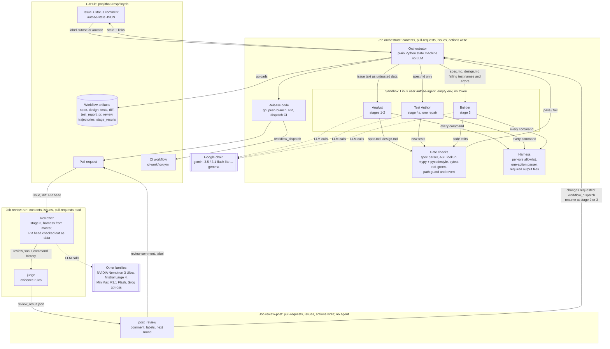

# Component view

The agents, their tools, and how they call each other, as built and run. Decisions referenced:
ADR-001 (agents), ADR-002 (control flow), ADR-003 (hand-offs), ADR-004 (state), ADR-011 (tools,
sandbox and credentials, superseding ADR-005), ADR-012 (models, superseding ADR-006), ADR-008 and
ADR-014 (reviewer), ADR-015 (action parsing), ADR-016 (design context).

## Agents and tools

| Agent | Stages | Tools (allowlist) | Model | Receives | Never receives |
|---|---|---|---|---|---|
| Analyst | 1 Requirements, 2 Design | read-only file commands | Google chain | issue text (wrapped as untrusted), A1 skill, the short architecture map, base code | Builder output, tests |
| Test Author | 4a, plus one repair | read; write its one test file; pytest | Google chain | spec.md, base code; for a repair, only the failure messages | design.md, Builder's code and reasoning |
| Builder | 3 | read; edit inside `tinydb/`; python, pytest, mypy, pycodestyle | Google chain | spec.md, design.md, base code, failing test names and errors | test source code, ARCHITECTURE.md |
| Reviewer | 6 | read and run in a throwaway checkout; write `_review/` scratch tests | other family (NVIDIA chain) | issue, diff, PR head, ARCHITECTURE.md | spec.md, design.md, test_report.md, transcripts, PR description |

Plain code, not agents: the Orchestrator (stage routing), every gate check, the Release code
(stage 5), the review `judge` and `post_review`. Only plain code holds a GitHub token. `git`,
the network, `pip` and `env` are blocked for every agent. The workflow never merges; a person does.
