# Component view

The agents, their tools, and how they call each other. Decisions referenced: ADR-001 (agents),
ADR-002 (control flow), ADR-003 (hand-offs), ADR-004 (state), ADR-005 (tools and credentials),
ADR-006 (models), ADR-008 (reviewer).

```mermaid
flowchart TB
    subgraph GH[GitHub: poojitha376sp/tinydb]
        ISS[Issue + status comment<br/>autose-state JSON]
        PR[Pull request]
        CI[CI workflow<br/>ci-workflow.yml]
        ART[(Workflow artifacts<br/>spec, design, diff,<br/>test_report, pr, review)]
    end

    subgraph J1[Job: orchestrate &#40;contents, pull-requests, issues, actions: write&#41;]
        ORC[Orchestrator<br/>plain Python state machine<br/>no LLM]
        GATE[Gate checks<br/>parsers, AST lookup, ruff, mypy,<br/>pytest red-green, path guard]
        REL[Release script<br/>gh: push, PR, dispatch CI]
        subgraph SBX[Agent sandbox: no GitHub token]
            AN[Analyst<br/>stages 1-2]
            TA[Test Author<br/>stage 4a]
            BU[Builder<br/>stages 3, 4b fixes]
        end
    end

    subgraph J2[Job: review &#40;contents: read; posts via plain code&#41;]
        RV[Reviewer<br/>stage 6<br/>throwaway checkout of PR head]
        RP[Review parser<br/>schema + evidence rule]
    end

    GEM[[Gemini Flash<br/>AI Studio free tier]]
    ALT[[Other model family<br/>GitHub Models, fallback Groq]]

    ISS -- label autose / &#47;autose --> ORC
    ORC -- issue text as untrusted data --> AN
    AN -- spec.md, design.md --> GATE
    ORC -- spec.md only --> TA
    TA -- new tests --> GATE
    ORC -- spec.md, design.md,<br/>failing test names --> BU
    BU -- code edits --> GATE
    GATE -- pass / fail --> ORC
    ORC --> REL
    REL --> PR
    REL -- workflow_dispatch --> CI
    ORC -- state + links --> ISS
    ORC -- uploads --> ART
    AN & TA & BU -. LLM calls .-> GEM
    PR -- issue, diff, PR head --> RV
    RV -. LLM calls .-> ALT
    RV --> RP
    RP -- review.md, verdict --> PR
    RP -- changes requested: workflow_dispatch<br/>resume at stage 2 or 3 --> ORC
```

## Agents and tools

| Agent | Stages | Tools | Model | Receives | Never receives |
|---|---|---|---|---|---|
| Analyst | 1 Requirements, 2 Design | read, grep, list files | Gemini Flash | issue text (wrapped as untrusted), A1 skill, ARCHITECTURE.md, file tree | none |
| Test Author | 4a | read; write new test files only; pytest | Gemini Flash | spec.md, base code | Builder's code and reasoning |
| Builder | 3, 4b fixes | read; edit inside `tinydb/`; allowlisted commands (pytest, ruff, mypy) | Gemini Flash | spec.md, design.md, repo, failing test names and errors | test source code |
| Reviewer | 6 | read and run anything in a throwaway checkout | other family (GitHub Models / Groq) | issue, diff, PR head | spec.md, design.md, test_report.md, transcripts |

Plain code, not agents: the Orchestrator (stage routing), every gate check, and the Release
script (stage 5). Only plain code holds a GitHub token. The workflow never merges; a person does.
