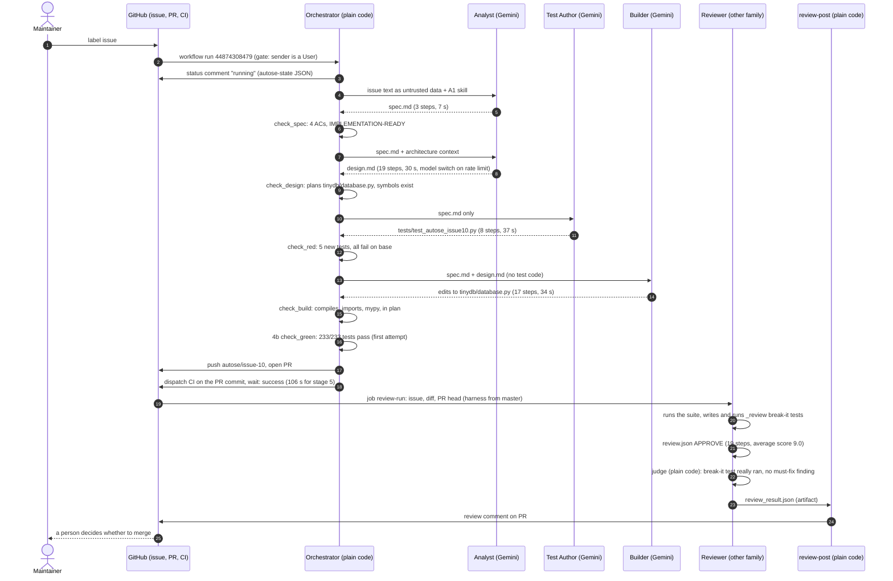

# Sequence view (a real run)

Issue I3, [#10](https://github.com/poojitha376sp/tinydb/issues/10) ("rename a table"), third
run: [44874308479](https://github.com/poojitha376sp/tinydb/actions/runs/44874308479). It ended
with [PR #19](https://github.com/poojitha376sp/tinydb/pull/19), green CI
([44874520635](https://github.com/poojitha376sp/tinydb/actions/runs/44874520635)) and an
independent APPROVE. Seconds, steps and tokens are copied from the run's `stage_results.json`
and `review_result.json` (`results/results.csv` has the same numbers). The code later passed
all 4 hidden tests.

Build stages total 290K tokens (Analyst 128K, Test Author 36K, Builder 126K); the review used
77K. At the time of this run the Reviewer was `gpt-oss-120b` on Groq; it later moved to NVIDIA
(ADR-012).

What does not show in this happy path, and where to see it:
- Stage 4b failing and going back to 3, or the same failure twice (ADR-002, ADR-013): I3's two
  earlier runs, 44790279547 and 44819950934, in `results/runs.md`.
- Stage 1 stopping on NOT-READY with open questions for a person: I5,
  [44874333544](https://github.com/poojitha376sp/tinydb/actions/runs/44874333544).
- A review that ends INCONCLUSIVE and is labelled `needs-human`: the PR #15 reviews.
